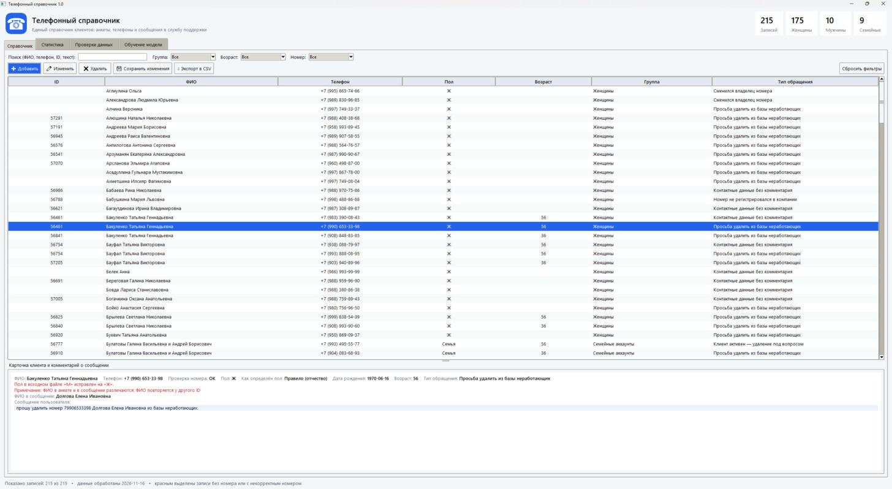

# Телефонный справочник

Учебная практика №2. Проектирование архитектуры и разработка телефонного справочника.

**Автор:** Статников Егор Сергеевич, группа 1ИИС-42
**Руководитель от АлтГТУ:** Барышева Надежда Николаевна
**Сроки практики:** 01.09.2026 – 22.11.2026



## Что делает программа

- Объединяет три файла (`Данные (ФИО)`, `Данные (ID, phone)`, `Текстовые сообщения`) в единый справочник телефонов. К каждой записи привязан комментарий: текст сообщения пользователя.
- Проверяет данные: пропуски, некорректные и нестандартные номера, дубликаты, конфликты ID, невозможные даты рождения.
- Группирует пользователей по возрасту и считает количество пользователей в каждой группе.
- Делит пользователей на мужчин, женщин и семейные аккаунты.
- Проверяет и исправляет пол: сначала по правилам (отчество, фамилия), затем обученной моделью (логистическая регрессия на символьных n-граммах ФИО).

## Запуск

Нужен Python 3.8 или новее. Дополнительные пакеты для работы программы не нужны.

- Windows: дважды щёлкнуть по `run.bat`
- Linux / macOS: `./run.sh`
- или вручную: `python src/app.py`

## Повторная обработка данных

```
pip install -r requirements.txt
python src/processing.py
```

Скрипт обновит `data/phonebook.json` (данные для программы) и `output/Справочник.xlsx` (справочник, статистика, проверки, исправления пола, метрики модели).

## Тестирование

```
python tests/run_tests.py
```

Скрипт прогоняет 25 тест-кейсов (номера телефонов, разбор сообщений, пол и классификация, поиск и фильтры, проверка ввода, экспорт) и сохраняет результаты в `tests/results.json`.

## Структура проекта

| Путь | Назначение |
|---|---|
| `run.bat`, `run.sh` | запуск программы |
| `src/app.py` | графический интерфейс (tkinter) |
| `src/processing.py` | обработка данных и обучение модели |
| `src/names_dict.py` | словарь имён для обучающей выборки |
| `tests/run_tests.py` | автоматический прогон тест-кейсов |
| `data/` | исходные файлы и `phonebook.json` |
| `output/Справочник.xlsx` | результаты обработки |
| `assets/` | иконка телефона |
| `screenshot.png` | скриншот интерфейса |
| `Presentation.pptx` | презентация |
| `Instruction.docx` | инструкция пользователя |

## Основные результаты

| Показатель | Значение |
|---|---|
| Записей в справочнике | 215 (204 клиента) |
| Женщины / мужчины / семейные аккаунты / не определено | 164 / 10 / 9 / 21 |
| Возраст 30–39 / 50–59 / 60+ / не указан | 21 / 30 / 9 / 144 |
| Исправлен пол | у 37 клиентов |
| Точность модели (кросс-валидация, 5 блоков) | 99,9 % |
